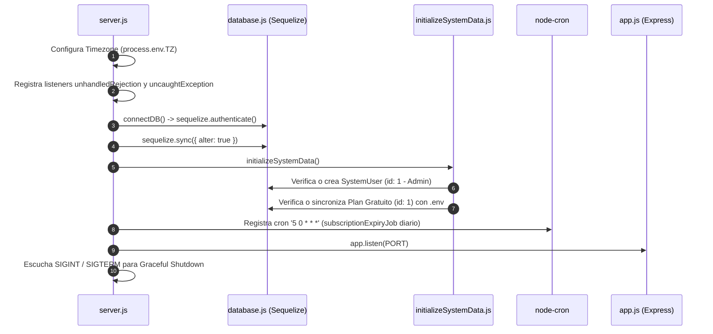
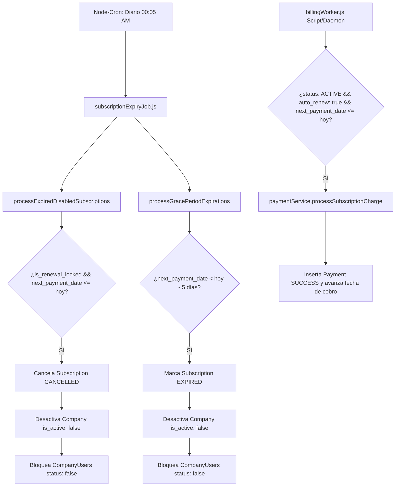

# MANUAL TÉCNICO Y ARQUITECTURA DEL BACKEND (Carnet Digital)

Este documento detalla la totalidad del sistema backend de **Carnet Digital**: su arquitectura, ciclo de vida, modelos de datos, flujos de ejecución, conexiones entre capas, validaciones, variables de entorno, tareas en segundo plano y el catálogo completo de endpoints con sus datos de entrada y salida.

---

## 1. INFORMACIÓN GENERAL Y STACK TECNOLÓGICO

* **Entorno de Ejecución:** Node.js (v18+)
* **Framework Web:** Express 5 (`^5.2.1`)
* **ORM y Persistencia:** Sequelize (`^6.37.8`) sobre motor MySQL (`mysql2 ^3.22.0`)
* **Autenticación y Criptografía:** JSON Web Tokens (`jsonwebtoken ^9.0.3`), `bcryptjs ^3.0.3`
* **Validación de Datos:** Joi (`^18.1.2`)
* **Manejo de Archivos:** Multer (`^2.1.1`)
* **Pasarela de Pagos:** SDK Oficial de Mercado Pago (`mercadopago ^2.12.0`)
* **Seguridad y Rendimiento:** `helmet ^8.1.0`, `cors ^2.8.6`, `compression ^1.8.1`, `express-rate-limit ^8.3.2`, `connect-timeout ^1.9.1`
* **Caché en Memoria:** `node-cache ^5.1.2`
* **Logging y Auditoría:** `winston ^3.19.0`, `morgan ^1.10.1`, Node.js `AsyncLocalStorage` (`async_hooks`)
* **Tareas Programadas:** `node-cron ^4.2.1`

---

## 2. VARIABLES DE ENTORNO (`.env`) Y CONEXIONES

| Variable | Tipo | Valor / Ejemplo | Módulos Consumidores | Impacto en el Sistema |
| :--- | :--- | :--- | :--- | :--- |
| `PORT` | Number | `4000` | `src/server.js` | Puerto TCP en el que se levanta el servidor HTTP. Fallback: `3010`. |
| `NODE_ENV` | String | `development` / `production` | `database.js`, `errorMiddleware.js` | En `development`: imprime consultas SQL debug y expone stack trace en errores. |
| `DB_HOST` | String | `localhost` | `src/config/database.js` | Host del servidor MySQL. |
| `DB_USER` | String | `root` | `src/config/database.js` | Usuario de MySQL. |
| `DB_PASSWORD` / `DB_PASS`| String | `*****` | `src/config/database.js` | Contraseña de MySQL. |
| `DB_NAME` | String | `CoreCredencial` | `src/config/database.js` | Base de datos principal. |
| `DB_DIALECT` | String | `mysql` | `src/config/database.js` | Dialecto de conexión Sequelize. |
| `DB_TIMEZONE` | String | `-05:00` | `src/config/database.js` | Zona horaria aplicada a las conexiones de DB. |
| `APP_TIMEZONE` | String | `America/Bogota` | `src/server.js` | Fija `process.env.TZ` a nivel de proceso de Node.js. |
| `JWT_SECRET` | String | Cadena hexadecimal 32+ chars | `authMiddleware.js`, `authService.js` | Clave secreta para firmar y verificar tokens de sesión. |
| `JWT_EXPIRES_IN` | String | `1h` | `authService.js` | Tiempo de vida del token JWT. |
| `ADMIN_DEFAULT_EMAIL` | String | `Admin@admin` | `initializeSystemData.js` | Correo del SuperAdmin global sembrado automáticamente en arranque (`id: 1`). |
| `ADMIN_DEFAULT_PASSWORD` | String | `*****` | `initializeSystemData.js` | Contraseña en texto plano que se hashea con Bcrypt al sembrar el SuperAdmin. |
| `FREE_PLAN_NAME` | String | `Plan Gratuito` | `initializeSystemData.js` | Nombre del plan gratuito inicial (`id: 1`). |
| `FREE_PLAN_DESCRIPTION`| String | Texto explicativo | `initializeSystemData.js` | Descripción del plan gratuito. |
| `FREE_PLAN_PRICE` | Decimal | `0.00` | `initializeSystemData.js` | Precio mensual base del plan gratis. |
| `FREE_PLAN_MAX_USERS` | Integer | `10` | `initializeSystemData.js`, `planLimits.js` | Cuota máxima de colaboradores permitidos. |
| `FREE_PLAN_MAX_TEMPLATES`| Integer | `2` | `initializeSystemData.js`, `planLimits.js` | Cuota máxima de plantillas de carnets. |
| `FREE_PLAN_MAX_CARNETS`| Integer | `5` | `initializeSystemData.js`, `planLimits.js` | Cuota máxima de carnets generados. |
| `FREE_PLAN_MAX_EVENTS` | Integer | `3` | `initializeSystemData.js`, `planLimits.js` | Cuota máxima de eventos mensuales. |
| `FREE_PLAN_MAX_HEADQUARTERS`| Integer | `1` | `initializeSystemData.js`, `planLimits.js` | Cuota máxima de sedes por empresa. |
| `FREE_PLAN_MAX_AREAS` | Integer | `5` | `initializeSystemData.js`, `planLimits.js` | Cuota máxima de departamentos/áreas. |
| `FREE_PLAN_MAX_ROLES` | Integer | `10` | `initializeSystemData.js`, `planLimits.js` | Cuota máxima de cargos por empresa. |
| `MERCADOPAGO_TEST_PUBLIC_KEY` | String | `APP_USR-...` | `systemParameterService.js` | Clave pública de Mercado Pago en modo Sandbox. |
| `MERCADOPAGO_TEST_ACCESS_TOKEN`| String | `APP_USR-...` | `mercadopagoService.js` | Token de acceso para la API de Mercado Pago en modo Sandbox. |
| `MERCADOPAGO_PROD_PUBLIC_KEY` | String | `APP_USR-...` | `systemParameterService.js` | Clave pública en modo Producción. |
| `MERCADOPAGO_PROD_ACCESS_TOKEN`| String | `APP_USR-...` | `mercadopagoService.js` | Token de acceso para la API en modo Producción. |
| `BACKEND_URL` | String | `http://localhost:4000` | `mercadopagoService.js` | URL pública del backend para componer la `notification_url` del webhook. |
| `MERCADOPAGO_BACK_URL` | String | `http://localhost:5173/payment-success` | `mercadopagoService.js` | URL de retorno hacia el frontend tras procesar el pago. |
| `MERCADOPAGO_CURRENCY` | String | `COP` | `mercadopagoService.js` | Moneda de cobro en Mercado Pago. |
| `MERCADOPAGO_WEBHOOK_SECRET` | String | Clave secreta webhook | `mercadopagoService.js` | Secreto criptográfico para verificar la firma HMAC `x-signature` del Webhook. |

---

## 3. CICLO DE VIDA DEL SERVIDOR Y PIPELINE DE PETICIONES

### 3.1 Inicialización del Proceso (`src/server.js`)


### 3.2 Pipeline de Middlewares Globales (`src/app.js`)
Toda petición entrante recorre la cadena en el siguiente orden secuencial:

1. **`connect-timeout('15s')`:** Asigna un temporizador de 15 segundos. Si la petición no responde en ese tiempo, `req.timedout` se activa y genera error HTTP 503.
2. **`express.static('/uploads')`:** Sirve recursos estáticos (`uploads/logos`, `uploads/banners`) con cabecera `Cache-Control: public, max-age=604800, immutable` (7 días).
3. **`compression()`:** Compresión Gzip para reducir payload en respuestas HTTP.
4. **`contextMiddleware`:** Inicializa el almacén `AsyncLocalStorage` (`Context.run({}, next)`).
5. **`helmet()`:** Inyecta cabeceras de seguridad HTTP (XSS Filter, HSTS, no-sniff).
6. **`cors()`:** Habilita peticiones cruzadas para el frontend.
7. **`morgan('combined')`:** Intercepta logs HTTP y los redirige al stream de Winston.
8. **`express.json({ limit: '1mb' })` y `express.urlencoded`:** Parseo de cuerpos JSON y URL-encoded restringidos a 1 MB.
9. **`apiLimiter` (Rate Limiting General):** Ventana de 15 minutos, máximo 150 peticiones por IP en `/api`.
10. **`authLimiter` (Rate Limiting Autenticación):** Ventana de 15 minutos, máximo 10 peticiones por IP en `/api/auth`.
11. **Enrutador Central (`/api`, `src/routes/index.js`):** Deriva a los módulos específicos.
12. **`errorMiddleware`:** Capturador centralizado de errores. Traduce excepciones de Sequelize, Timeouts, errores 404/403/400 de `AppError` y registra stack traces con Winston.

---

## 4. CONTEXTO ASÍNCRONO Y AUDITORÍA AUTOMÁTICA

El sistema implementa auditoría continua sin necesidad de invocar logs manualmente en cada controlador:

### 4.1 Funcionamiento de `AsyncLocalStorage` (`src/utils/context.js`)
* Permite conservar variables de contexto a través de la cadena asíncrona de funciones de una petición sin pasarlas como parámetros.
* En `authMiddleware.js`, al decodificar un JWT válido:
  * `Context.set('userId', decoded.id)`
  * `Context.set('companyId', decoded.company_id)`
  * `Context.set('companyUserId', decoded.id)`

### 4.2 Interceptores de Modelos (`src/utils/logHooks.js`)
En `src/models/index.js`, todos los modelos se registran mediante `attachLogHooks(model, type, models)`.

* **Modelos de Sistema:** `Company`, `Plan`, `SystemUser`, `SystemRol`, `SystemParameter`.
* **Modelos de Compañía:** `CompanyParameter`, `Subscription`, `InstallationMode`, `CompanyUser`, `CompanyArea`, `CompanyRol`, `CompanyHeadquarter`, `CompanyCarnet`, `CompanyTemplateCarnet`, `CompanyEvent`, `PaymentMethod`, `Payment`.
* **Eventos interceptados:** `afterCreate`, `afterUpdate`, `afterDestroy`.
* **Datos capturados:**
  * `action`: `'CREATE'`, `'UPDATE'` o `'DELETE'`.
  * `table_name`: Nombre de la tabla afectada.
  * `record_id`: Identificador de la fila modificada.
  * `before`: JSON del estado anterior (extraído de `instance._previousDataValues`).
  * `after`: JSON del nuevo estado (extraído de `instance.dataValues`).
  * `user_id` / `id_user_company`: Extraído de forma transparente desde `Context.getStore()`.
  * Persistidos en la tabla `system_logs` o `company_logs`.

---

## 5. MODELO DE DATOS Y ASOCIACIONES (SEQUELIZE)

### 5.1 Diccionario de Tablas y Columnas

#### A. Capa Core y Plataforma
* **`companies` (`Company`):**
  * `id` (INT, PK, AutoInc)
  * `name` (VARCHAR, NOT NULL)
  * `nit_id` (VARCHAR, UNIQUE)
  * `subdomain` (VARCHAR, UNIQUE)
  * `path_image` (TEXT, Nullable): URL relativa del logo institucional.
  * `is_active` (BOOLEAN, default: true): Estado operativo de la empresa.
  * `plan_id` (INT, FK -> `plans.id`): Plan de suscripción contratado.
  * `active_subscription_id` (INT, FK -> `subscriptions.id`): Suscripción vigente.

* **`plans` (`Plan`):**
  * `id` (INT, PK, AutoInc)
  * `name` (VARCHAR, NOT NULL)
  * `description` (TEXT, NOT NULL)
  * `price` (DECIMAL(10,2), default: 0.00): Precio mensual base.
  * `max_users` (INT): Límite de colaboradores.
  * `max_templates_carnets` (INT): Límite de plantillas de carnets.
  * `max_carnets` (INT): Límite de carnets emitidos.
  * `max_events_month` (INT): Límite de eventos al mes.
  * `max_headquarters` (INT): Límite de sedes físicas.
  * `max_areas` (INT): Límite de departamentos.
  * `max_roles` (INT): Límite de cargos.
  * `is_active` (BOOLEAN, default: true)
  * `is_default` (BOOLEAN, default: false): Marca el plan por defecto para registros nuevos.

* **`subscriptions` (`Subscription`):**
  * `id` (INT, PK, AutoInc)
  * `company_id` (INT, FK -> `companies.id`, NOT NULL)
  * `plan_id` (INT, FK -> `plans.id`, NOT NULL)
  * `status` (ENUM: `'ACTIVE'`, `'EXPIRED'`, `'CANCELLED'`, `'TRIAL'`, `'PENDING_PAYMENT'`)
  * `start_date` (DATETIME, NOT NULL)
  * `end_date` (DATETIME, Nullable)
  * `billing_cycle` (ENUM: `'MONTHLY'`, `'YEARLY'`)
  * `next_payment_date` (DATETIME, Nullable)
  * `auto_renew` (BOOLEAN, default: true)
  * `is_renewal_locked` (BOOLEAN, default: false): Si es `true`, bloquea cambios manuales por proceso de desactivación diferida.
  * `payment_method_id` (INT, FK -> `payment_methods.id`, Nullable)

* **`payments` (`Payment`):**
  * `id` (INT, PK, AutoInc)
  * `subscription_id` (INT, FK -> `subscriptions.id`, NOT NULL)
  * `company_id` (INT, FK -> `companies.id`, NOT NULL)
  * `payment_method_id` (INT, FK -> `payment_methods.id`, Nullable)
  * `amount` (DECIMAL(10,2), NOT NULL)
  * `currency` (VARCHAR(3), default: `'COP'`)
  * `status` (ENUM: `'PENDING'`, `'SUCCESS'`, `'FAILED'`, `'REFUNDED'`)
  * `gateway_transaction_id` (VARCHAR, Nullable): ID de pago emitido por Mercado Pago.
  * `payment_date` (DATETIME, default: NOW)
  * `notes` (TEXT, Nullable)

* **`payment_methods` (`PaymentMethod`):**
  * `id` (INT, PK, AutoInc)
  * `company_id` (INT, FK -> `companies.id`, NOT NULL)
  * `gateway_name` (VARCHAR, NOT NULL, ej: `'mercado_pago'`)
  * `gateway_customer_id` (VARCHAR, Nullable)
  * `token` (VARCHAR, NOT NULL)
  * `last_four` (VARCHAR(4), Nullable)
  * `brand` (VARCHAR, Nullable)
  * `expiry_date` (VARCHAR(7), Nullable)
  * `is_default` (BOOLEAN, default: false)
  * `is_active` (BOOLEAN, default: true)

* **`company_parameters` (`CompanyParameter`):**
  * `id` (INT, PK, AutoInc)
  * `company_id` (INT, FK -> `companies.id`, UNIQUE, NOT NULL)
  * `login` (BOOLEAN, default: true): Habilita o restringe el acceso de usuarios.
  * `maintenance` (BOOLEAN, default: false): Modo mantenimiento institucional.
  * `primary_color` (VARCHAR, default: `'#0062E3'`)
  * `secondary_color` (VARCHAR, default: `'#001F3F'`)
  * `font_family` (VARCHAR, default: `'Inter'`)
  * `border_radius` (VARCHAR, default: `'12px'`)
  * `sidebar_theme` (ENUM: `'dark'`, `'light'`, `'brand'`, default: `'dark'`)

* **`system_users` (`SystemUser`):**
  * `id` (INT, PK, AutoInc)
  * `name` (VARCHAR, NOT NULL)
  * `email` (VARCHAR, UNIQUE, NOT NULL)
  * `password` (VARCHAR, NOT NULL): Hasheada con bcrypt (10 rounds).
  * `system_role` (ENUM: `'admin'`, `'common'`, default: `'common'`)
  * `system_rol_id` (INT, FK -> `system_rols.id`, Nullable)
  * `status` (BOOLEAN, default: true)
  * *Hooks:* `beforeSave` hashea contraseña si cambia. `beforeDestroy` y `beforeUpdate` prohíben eliminar o desactivar al ID 1.

* **`system_parameters` (`SystemParameter`):**
  * `id` (INT, PK, AutoInc - Singleton forzado a ID: 1)
  * `login` (BOOLEAN, default: true)
  * `maintenance` (BOOLEAN, default: false)
  * `path_image_system` (TEXT, Nullable)
  * `mercadopago_mode` (ENUM: `'SANDBOX'`, `'PRODUCTION'`, default: `'SANDBOX'`)

* **`banners` (`Banner`):**
  * `id` (INT, PK, AutoInc)
  * `title` (VARCHAR, Nullable)
  * `subtitle` (VARCHAR, Nullable)
  * `image_url` (VARCHAR, NOT NULL)
  * `link_url` (VARCHAR, Nullable)
  * `order` (INT, default: 0)
  * `is_active` (BOOLEAN, default: true)

#### B. Capa Tenant (Empresas)
* **`company_users` (`CompanyUser`):**
  * `id` (INT, PK, AutoInc)
  * `company_id` (INT, FK -> `companies.id`, NOT NULL)
  * `company_rol_id` (INT, FK -> `company_rols.id`, Nullable)
  * `company_area_id` (INT, FK -> `company_areas.id`, Nullable)
  * `company_headquarter_id` (INT, FK -> `company_headquarters.id`, Nullable)
  * `company_carnet_id` (INT, Nullable)
  * `first_name` (VARCHAR, NOT NULL)
  * `last_name` (VARCHAR, NOT NULL)
  * `type_id` (VARCHAR(45), NOT NULL, ej: `'CC'`, `'TI'`)
  * `number_id` (VARCHAR(20), UNIQUE, NOT NULL)
  * `rh_type` (VARCHAR, Nullable)
  * `company_email` (VARCHAR, UNIQUE, NOT NULL)
  * `staff_mail` (VARCHAR(100), NOT NULL)
  * `staff_phone` (VARCHAR(45), Nullable)
  * `password` (VARCHAR, NOT NULL): Hasheada con bcrypt (10 rounds).
  * `system_role` (ENUM: `'admin'`, `'visualizer'`, `'common'`, `'roster'`, `'retired'`)
  * `status` (BOOLEAN, default: true)
  * `is_protected` (BOOLEAN, default: false): Si es `true` (admin inicial), no puede ser eliminado ni cuenta para el límite de colaboradores del plan.

* **`company_carnets` (`CompanyCarnet`):**
  * `id` (INT, PK, AutoInc)
  * `company_id` (INT, FK -> `companies.id`, NOT NULL)
  * `carnet_id` (INT, UNIQUE, NOT NULL): Número consecutivo/identificador público.
  * `template_id` (INT, FK -> `company_template_carnets.id`, NOT NULL)
  * `type_carnet` (VARCHAR, NOT NULL)
  * `token_carnet` (VARCHAR, UNIQUE, NOT NULL): Token criptográfico para validación QR.
  * `status` (VARCHAR, NOT NULL, ej: `'ACTIVE'`, `'INACTIVE'`, `'EXPIRED'`)
  * `valid_from` (DATETIME, NOT NULL)
  * `valid_to` (DATETIME, NOT NULL)

* **`company_template_carnets` (`CompanyTemplateCarnet`):**
  * `id` (INT, PK, AutoInc)
  * `company_id` (INT, FK -> `companies.id`, NOT NULL)
  * `template_name` (VARCHAR, NOT NULL)
  * `value_template` (JSON, NOT NULL): Coordenadas, capas y estilos del carnet.
  * `html_template` (LONGTEXT, NOT NULL): Estructura del carnet lista para render.
  * `path_image_template` (LONGTEXT, NOT NULL): Fondo o vista previa.
  * `is_active` (BOOLEAN, default: true)

* **`company_headquarters` (`CompanyHeadquarter`):**
  * `id` (INT, PK, AutoInc)
  * `company_id` (INT, FK -> `companies.id`, NOT NULL)
  * `name` (VARCHAR, NOT NULL)
  * `address` (VARCHAR, Nullable)
  * `city` (VARCHAR, Nullable)
  * `phone` (VARCHAR, Nullable)
  * `is_main` (BOOLEAN, default: false): Sede principal. Si se activa, las demás se apagan.
  * `status` (BOOLEAN, default: true)

* **`company_areas` (`CompanyArea`):**
  * `id` (INT, PK, AutoInc)
  * `company_id` (INT, FK -> `companies.id`, NOT NULL)
  * `company_headquarter_id` (INT, FK -> `company_headquarters.id`, Nullable)
  * `area_name` (VARCHAR, NOT NULL)
  * `description` (TEXT, Nullable)

* **`company_rols` (`CompanyRol`):**
  * `id` (INT, PK, AutoInc)
  * `company_id` (INT, FK -> `companies.id`, NOT NULL)
  * `company_headquarter_id` (INT, FK -> `company_headquarters.id`, Nullable)
  * `rol_name` (VARCHAR, NOT NULL)
  * `description` (TEXT, Nullable)
  * `is_protected` (BOOLEAN, default: false): El rol Admin base no se puede eliminar.

---

## 6. SEGURIDAD, AUTENTICACIÓN Y CONTROL DE ACCESO

### 6.1 Estructura del Token JWT
Firmado con `process.env.JWT_SECRET` y expiración en `JWT_EXPIRES_IN`.

* **Token de Administrador de Sistema (`type: 'system'`):**
  ```json
  {
    "id": 1,
    "email": "Admin@admin",
    "role": "admin",
    "type": "system",
    "iat": 1727280000,
    "exp": 1727283600
  }
  ```
* **Token de Usuario de Empresa (`type: 'company'`):**
  ```json
  {
    "id": 5,
    "email": "admin@empresa.com",
    "company_id": 2,
    "role": "admin",
    "type": "company",
    "iat": 1727280000,
    "exp": 1727283600
  }
  ```
* **Token de Impersonación / Proxy (`is_proxy: true`):**
  ```json
  {
    "id": 1,
    "email": "Admin@admin",
    "company_id": 2,
    "role": "admin",
    "type": "company",
    "is_proxy": true,
    "company_name": "Colegio San José",
    "iat": 1727280000,
    "exp": 1727283600
  }
  ```

### 6.2 Middlewares de Autorización (`src/middleware/authMiddleware.js`)
1. **`verifyToken(req, res, next)`:** Extrae `Authorization: Bearer <token>`. Verifica firma y vigencia. Inyecta `req.user = decoded` y puebla el almacén `Context`. Si falta o expiró, retorna `401` o `403`.
2. **`isSystem(req, res, next)`:** Exige que `req.user.type === 'system'`. Si no, retorna `403 Forbidden: Acceso restringido a administradores del sistema`.
3. **`isCompany(req, res, next)`:** Exige que `req.user.type === 'company'`. Si no, retorna `403 Forbidden: Acceso restringido a usuarios de compañía`.

---

## 7. MOTOR DE VALIDACIÓN DE LÍMITES DE PLAN (`src/utils/planLimits.js`)

Se invoca en la creación de recursos tenant antes de persistir en base de datos:

```javascript
await checkPlanLimit(companyId, 'users' | 'areas' | 'roles' | 'templates' | 'carnets' | 'headquarters' | 'events');
```

### Reglas de Negocio Aplicadas:
1. Localiza la suscripción activa (`status = 'ACTIVE'`) para el `company_id`. Si no existe o no tiene un plan asociado, rechaza con `AppError('No se encontró una suscripción activa...', 403)`.
2. Ejecuta conteo en la tabla correspondiente:
   * **`users`:** Cuenta `CompanyUser` donde `is_protected = false`. Compara contra `plan.max_users`.
   * **`roles`:** Cuenta `CompanyRol` donde `is_protected = false`. Compara contra `plan.max_roles`.
   * **`areas`:** Cuenta `CompanyArea`. Compara contra `plan.max_areas`.
   * **`templates`:** Cuenta `CompanyTemplateCarnet`. Compara contra `plan.max_templates_carnets`.
   * **`carnets`:** Cuenta `CompanyCarnet`. Compara contra `plan.max_carnets`.
   * **`headquarters`:** Cuenta `CompanyHeadquarter`. Compara contra `plan.max_headquarters`.
   * **`events`:** Cuenta `CompanyEvent`. Compara contra `plan.max_events_month`.
3. Si `maxLimit > 0` y `currentCount >= maxLimit`, arroja una excepción `AppError(403)` con el mensaje personalizado para que el usuario actualice su suscripción.

---

## 8. CATÁLOGO COMPLETO DE ENDPOINTS (API REFERENCE)

### 8.1 Módulo: Autenticación (`/api/auth`)

#### `POST /api/auth/login` (Login Unificado)
* **¿Qué hace?** Autentica a cualquier usuario. Busca primero en `company_users` (Tenant); si coincide, valida que la empresa esté activa y que la suscripción no haya vencido. Si no existe, busca en `system_users` (Sistema).
* **¿Qué recibe?**
  * Headers: `Content-Type: application/json`
  * Body:
    ```json
    {
      "email": "usuario@dominio.com",
      "password": "Password123"
    }
    ```
* **¿Qué valida?**
  * `email` válido y requerido. `password` requerido (Joi `loginSchema`).
  * Contraseña correcta mediante `bcrypt.compare`.
  * `user.status === true`.
  * En Tenant: `company.is_active === true`.
  * En Tenant: si `subscription.next_payment_date < today`, rechaza con `402 Payment Required` y entrega el `subscription_id` para proceder con el pago.
* **¿Qué envía?**
  * **200 OK:**
    ```json
    {
      "success": true,
      "message": "Sesión iniciada correctamente",
      "data": {
        "token": "eyJhbGciOiJIUzI1NiIsInR5cCI6IkpXVCJ9...",
        "user": {
          "id": 1,
          "first_name": "Juan",
          "last_name": "Pérez",
          "company_id": 2,
          "role": "admin",
          "type": "company"
        }
      }
    }
    ```
  * **401 Unauthorized:** `{"success": false, "message": "Credenciales inválidas"}`
  * **402 Payment Required:** `{"success": false, "message": "Tu suscripción ha vencido...", "subscription_id": 4}`
  * **403 Forbidden:** `{"success": false, "message": "Esta empresa ha sido desactivada"}`

#### `POST /api/auth/register` (Registro Público de Empresa)
* **¿Qué hace?** Onboarding transaccional completo: crea la empresa, la suscripción, los parámetros visuales, el rol Admin base, el usuario administrador y genera la preferencia de Mercado Pago si el plan tiene costo.
* **¿Qué recibe?**
  * Headers: `Content-Type: multipart/form-data`
  * Archivo: `logo` (imagen JPG, PNG, WEBP, máx 2MB)
  * Campos Body:
    ```json
    {
      "fullname": "Carlos Mario Gómez",
      "company_name": "Gómez Security S.A.S",
      "email": "carlos@gomezsecurity.com",
      "password": "MiPasswordSegura123",
      "nit_id": "901234567-8",
      "type_id": "NIT",
      "number_id": "901234567",
      "plan_id": 2,
      "billing_cycle": "MONTHLY",
      "primary_color": "#0062E3",
      "secondary_color": "#001F3F",
      "font_family": "Inter",
      "border_radius": "12px",
      "sidebar_theme": "dark"
    }
    ```
* **¿Qué valida?**
  * Joi `registerSchema`.
  * Unicidad de `nit_id` en `companies`.
  * Unicidad de `email` en `company_users` y `system_users`.
  * Existencia y estado activo del `plan_id`.
* **¿Qué envía?**
  * **201 Created:**
    ```json
    {
      "success": true,
      "message": "Registro casi completo. Redirigiendo al pago...",
      "data": {
        "success": true,
        "payment_link": "https://www.mercadopago.com.co/checkout/v1/redirect?pref_id=...",
        "mp_subscription_id": "123456789-abcdef",
        "user": {
          "id": 10,
          "email": "carlos@gomezsecurity.com",
          "company": "Gómez Security S.A.S"
        }
      }
    }
    ```

#### `GET /api/auth/check-email/:email`
* **¿Qué hace?** Comprueba si un correo ya se encuentra en uso.
* **¿Qué recibe?** Param `:email`.
* **¿Qué envía?**
  * **200 OK:**
    ```json
    {
      "success": true,
      "exists": false,
      "message": "Correo disponible",
      "data": { "exists": false }
    }
    ```

#### `GET /api/auth/payment-config`
* **¿Qué hace?** Entrega el modo de operación (`SANDBOX` o `PRODUCTION`) y la clave pública correspondiente de Mercado Pago para inicializar el checkout en React.
* **¿Qué envía?**
  * **200 OK:**
    ```json
    {
      "success": true,
      "data": {
        "mode": "SANDBOX",
        "publicKey": "APP_USR-3350a548-..."
      }
    }
    ```

#### `GET /api/auth/refresh`
* **¿Qué hace?** Emite un nuevo token JWT a partir de un token vigente.
* **¿Qué recibe?** Header `Authorization: Bearer <token>`.
* **¿Qué envía?**
  * **200 OK:** `{"success": true, "data": {"token": "eyJhbGciOi..."}}`

---

### 8.2 Módulo: Empresas (`/api/companies`)

#### `GET /api/companies` (Listado Global de Empresas)
* **Permisos:** `verifyToken`, `isSystem`.
* **Query Params:** `page` (default 1), `limit` (default 20), `search` (filtra por `name` o `nit_id`).
* **Respuesta 200 OK:**
  ```json
  {
    "success": true,
    "message": "Empresas obtenidas correctamente",
    "data": [
      {
        "id": 1,
        "name": "Empresa Demo",
        "nit_id": "123456789",
        "subdomain": "empresademo",
        "is_active": true,
        "plan_id": 1
      }
    ],
    "meta": { "total": 1, "page": 1, "totalPages": 1 }
  }
  ```

#### `GET /api/companies/dashboard` (Métricas de la Empresa)
* **Permisos:** `verifyToken` (extrae `req.user.company_id`).
* **Respuesta 200 OK:**
  ```json
  {
    "success": true,
    "message": "Estadísticas del dashboard obtenidas correctamente",
    "data": {
      "stats": {
        "totalEmployees": 8,
        "totalAreas": 3,
        "totalRoles": 4,
        "totalTemplates": 1,
        "totalCarnets": 5,
        "totalHeadquarters": 1
      },
      "subscription": {
        "planName": "Plan Gratuito",
        "renewalDate": "2026-10-25T00:00:00.000Z",
        "limits": {
          "maxUsers": 10,
          "maxTemplates": 2,
          "maxCarnets": 5,
          "maxEvents": 3,
          "maxHeadquarters": 1,
          "maxAreas": 5,
          "maxRoles": 10
        }
      }
    }
  }
  ```

#### `POST /api/companies/:id/impersonate` (Proxy Login Administrativo)
* **Permisos:** `verifyToken`, `isSystem`.
* **Param:** `:id` (ID de la empresa a gestionar).
* **¿Qué hace?** Emite un token JWT firmado como administrador de la empresa seleccionada con `is_proxy: true`.
* **Respuesta 200 OK:**
  ```json
  {
    "success": true,
    "message": "Acceso concedido a la gestión de Gómez Security S.A.S",
    "data": {
      "token": "eyJhbGciOi...",
      "user": {
        "id": 1,
        "company_id": 2,
        "type": "company",
        "is_proxy": true,
        "company_name": "Gómez Security S.A.S"
      }
    }
  }
  ```

#### `PATCH /api/companies/:id/disable` (Desactivación Controlada)
* **Permisos:** `verifyToken`, `isSystem`.
* **¿Qué hace?** Si la empresa tiene suscripción vigente, la bloquea para renovaciones (`is_renewal_locked = true`, `auto_renew = false`) permitiendo servicio hasta `next_payment_date`. Si no tiene suscripción activa, la apaga inmediatamente y bloquea a todos sus usuarios.
* **Respuesta 200 OK:**
  ```json
  {
    "success": true,
    "message": "La empresa seguirá operativa hasta el 2026-10-24...",
    "data": {
      "deferred": true,
      "subscription_expires": "2026-10-24T18:00:00.000Z",
      "users_blocked": 0,
      "company_id": "2"
    }
  }
  ```

#### `PATCH /api/companies/:id/reactivate`
* **Permisos:** `verifyToken`, `isSystem`.
* **¿Qué hace?** Reactiva la empresa (`is_active = true`) y desbloquea exclusivamente al usuario administrador protegido (`is_protected: true`).
* **Respuesta 200 OK:** `{"success": true, "message": "Empresa reactivada. Solo el administrador inicial fue reactivado."}`

#### `PATCH /api/companies/:id/parameters` (Actualizar Branding)
* **Permisos:** `verifyToken`.
* **Form-Data:** `logo` (opcional), `primary_color`, `secondary_color`, `font_family`, `border_radius`, `sidebar_theme`, `login`, `maintenance`.
* **Respuesta 200 OK:** Retorna empresa y parámetros actualizados.

---

### 8.3 Módulo: Planes y Suscripciones (`/api/plans` y `/api/subscriptions`)

#### `GET /api/plans` (Público)
* **¿Qué hace?** Lista todos los planes activos con caché en memoria (`NodeCache` key: `'all_plans'`).
* **Respuesta 200 OK:** Array de planes ordenados ascendentemente por `price`.

#### `PUT /api/plans/:id` y `DELETE /api/plans/:id` (Solo Sistema)
* **¿Qué valida?** Impide modificar o borrar el Plan Gratuito (`id === 1`). Invalida automáticamente la clave `'all_plans'` en memoria.

#### `GET /api/subscriptions/my-subscription` (Solo Compañía)
* **¿Qué hace?** Devuelve la suscripción activa de la empresa actual, incluyendo el detalle del plan, método de pago predeterminado y el historial ordenado de pagos.

#### `PATCH /api/subscriptions/my-subscription` (Solo Compañía)
* **¿Qué hace?** Permite a la empresa alternar `auto_renew` o solicitar cambio de `plan_id` / `billing_cycle`.
* **¿Qué valida?** Si `subscription.is_renewal_locked === true`, rechaza la solicitud con `HTTP 403`.

---

### 8.4 Módulo: Pagos y Webhook de Mercado Pago (`/api/payments`)

#### `POST /api/payments/webhook` (Público - Validado Criptográficamente)
* **¿Qué hace?** Recibe notificaciones IPN/Webhook de Mercado Pago ante cobros de suscripciones.
* **¿Qué analiza/valida?**
  * Extrae cabecera `x-signature` y `x-request-id`.
  * Genera el manifest `id:<data.id>;request-id:<x-request-id>;ts:<ts>;` y computa el hash `HMAC-SHA256` contra `MERCADOPAGO_WEBHOOK_SECRET`. Si no coincide, responde `401 Invalid signature`.
* **Efectos Secundarios:**
  * Si `status === 'approved'`:
    * Inserta o actualiza fila en `payments` con `status: 'SUCCESS'`.
    * Actualiza `subscriptions`: marca `status: 'ACTIVE'`, avanza `next_payment_date` (+1 mes o +1 año) y guarda `last_payment_date`.
    * Garantiza `companies.is_active = true`.
  * Si `status === 'rejected'` o `'cancelled'`: Inserta o actualiza en `payments` con `status: 'FAILED'`.
* **Respuesta:** Siempre responde `HTTP 200 OK` con texto `'OK'` para confirmar recepción.

#### `GET /api/payments/my-history`
* **Permisos:** `verifyToken`, `isCompany`.
* **¿Qué envía?** Array de pagos de la empresa ordenados por `payment_date DESC`.

---

### 8.5 Módulo: Gestión de Colaboradores Tenant (`/api/company-users`)
*Protegido por `verifyToken`, `isCompany`.*

| Método | Endpoint | Validaciones / Límites | Respuesta |
| :--- | :--- | :--- | :--- |
| `GET` | `/` | Filtra estrictamente por `company_id` del token. Incluye Cargo, Área y Sede. | Array de colaboradores ordenados por apellido y nombre. |
| `GET` | `/:id` | Valida que pertenezca a la empresa. | Objeto del colaborador. |
| `POST` | `/` | Valida Joi `userSchema`. Ejecuta `checkPlanLimit(companyId, 'users')`. | `201 Created` con el usuario recién creado. |
| `PUT` | `/:id` | Valida Joi `userSchema`. Si se envía `password`, el hook lo hashea. | `200 OK` con datos actualizados. |
| `DELETE` | `/:id` | Si `user.is_protected === true`, rechaza el borrado con error. | `200 OK: Usuario eliminado exitosamente`. |

---

### 8.6 Módulo: Emisión y Control de Carnets (`/api/company-carnets`)
*Protegido por `verifyToken`, `isCompany`.*

* **`POST /api/company-carnets`:**
  * Valida Joi `carnetSchema`.
  * Ejecuta `checkPlanLimit(companyId, 'carnets')`.
  * Genera automáticamente un `token_carnet` criptográfico único de 16 bytes hexadecimales (`crypto.randomBytes(16).toString('hex')`) para verificación por código QR.
  * Si no se especifica `carnet_id`, genera un identificador numérico basado en timestamp.

---

### 8.7 Módulo: Sedes, Áreas y Cargos Tenant
*Protegido por `verifyToken`, `isCompany`.*

* **Sedes (`/api/company-headquarters`):** En `POST`, evalúa `checkPlanLimit(companyId, 'headquarters')`. Si se define `is_main: true`, ejecuta un `update` previo para desactivar `is_main` en las demás sedes de la empresa.
* **Cargos (`/api/company-rols`):** En `POST`, evalúa `checkPlanLimit(companyId, 'roles')`. En `DELETE`, impide la eliminación si `rol.is_protected === true` (Cargo Admin).
* **Áreas (`/api/company-areas`):** En `POST`, evalúa `checkPlanLimit(companyId, 'areas')`.

---

### 8.8 Módulo: Administración Global de Plataforma (`/api/system-*` y `/api/banners`)
*Protegido por `verifyToken`, `isSystem`.*

* **`system-users`:** Operadores del SaaS. Impide borrar o desactivar al Admin ID 1.
* **`system-parameters`:** Consulta y modificación del Singleton de configuración (`id: 1`). Permite alternar Mercado Pago entre `SANDBOX` y `PRODUCTION`.
* **`system-logs`:** Consulta con paginación de los últimos snapshots registrados por los hooks automáticos de Sequelize.
* **`banners`:** Gestión de banners publicitarios. En `DELETE`, localiza y elimina físicamente el archivo de la imagen del disco duro (`fs.unlinkSync`).

---

## 9. TAREAS ASÍNCRONAS Y JOBS EN SEGUNDO PLANO



1. **`src/jobs/subscriptionExpiryJob.js`:**
   * Se dispara automáticamente todas las noches a las 00:05 AM.
   * Ejecuta el cierre definitivo de empresas con baja diferida alcanzada.
   * Ejecuta el corte del servicio para aquellas empresas que no pagaron dentro de los 5 días de gracia.
2. **`src/workers/billingWorker.js`:**
   * Ejecutable por terminal o servicio independiente (`node src/workers/billingWorker.js`).
   * Itera sobre todas las suscripciones activas cuya fecha de cobro venció y que cuenten con `auto_renew: true`.
   * Ejecuta el débito a través del método de pago predeterminado y actualiza el ciclo.

---

## 10. RESUMEN DE CONEXIÓN ENTRE CAPAS

```
[ Petición HTTP ] 
       │
       ▼
[ Pipeline Middlewares ] ────► Timeout 15s ─► Cors ─► ContextStore ─► Helmet ─► Morgan ─► RateLimiter
       │
       ▼
[ authMiddleware ] ──────────► Valida JWT ─► Inyecta Context (userId, companyId) ─► Valida Rol
       │
       ▼
[ validateMiddleware ] ──────► Valida Payload con esquemas Joi
       │
       ▼
[ Controlador (Controller) ] ─► Extrae Params, Query, Body y Contexto
       │
       ▼
[ Capa de Servicio (Service) ]─► Lógica de Negocio ─► checkPlanLimit() ─► Pasarela Mercado Pago
       │
       ▼
[ Capa ORM (Sequelize Models)]─► Transacciones ACID ─► Hooks beforeSave/beforeUpdate
       │
       ├─────────────────────► logHooks (Snapshots automáticos JSON a system_logs / company_logs)
       ▼
[ Base de Datos MySQL ]
```
