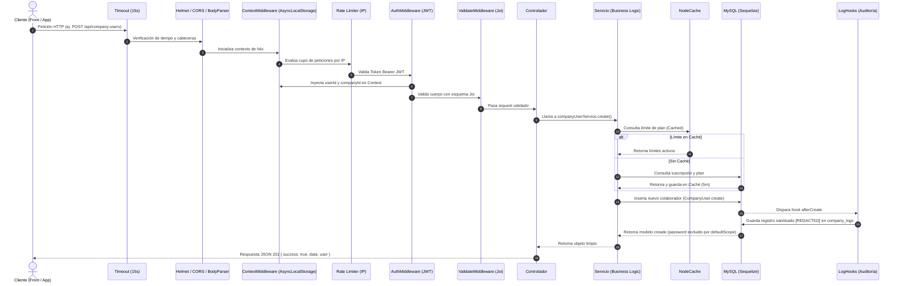

# MANUAL MAESTRO DE ARQUITECTURA Y CÓDIGO (CoreCredential Backend v2)

Este documento constituye la **referencia técnica definitiva y pedagógica** de la arquitectura, flujos de datos, modelos, seguridad y buenas prácticas implementadas en el backend de **CoreCredential (Carnet Digital)**.

---

## 🏛️ 1. Visión General y Stack Tecnológico

El backend es una aplicación **RESTful multi-tenant de alto rendimiento** diseñada para la emisión, validación y administración de credenciales y carnets digitales institucionales, con soporte para planes de suscripción, pasarela de pago (Mercado Pago) y auditoría transversal.

### Stack Tecnológico:
* **Entorno de Ejecución:** Node.js (v18+ / v22 LTS Alpine en Docker)
* **Framework Web:** Express 5 (`^5.2.1`)
* **ORM & Base de Datos:** Sequelize (`^6.37.8`) sobre motor MySQL 8 (`mysql2 ^3.22.0`)
* **Autenticación & Sesión:** JWT (`jsonwebtoken ^9.0.3`) y hashing con `bcryptjs ^3.0.3`
* **Auditoría & Trazabilidad:** Node.js `AsyncLocalStorage` (`async_hooks`), `winston ^3.19.0`, `morgan ^1.10.1`
* **Validación de Esquemas:** Joi (`^18.1.2`)
* **Caché en Memoria:** `node-cache ^5.1.2` (Patrón Cache-Aside)
* **Seguridad:** `helmet ^8.1.0`, `cors ^2.8.6`, `compression ^1.8.1`, `express-rate-limit ^8.3.2`, `connect-timeout ^1.9.1`
* **Tareas Programadas (Jobs):** `node-cron ^4.2.1`
* **Documentación:** Swagger OpenAPI 3.0 interactivo vía CDN en `/api/docs`

---

## 📂 2. Estructura de Directorios y Responsabilidades

```
CoreCredential-Back-v2/
├── .env                              # Variables de entorno (credenciales, puertos, llaves)
├── Dockerfile                        # Imagen multi-stage ligera de producción (Alpine)
├── docker-compose.yml                # Orquestación con backend + MySQL 8 con healthcheck
├── package.json                      # Dependencias y scripts de ejecución
├── uploads/                          # Almacenamiento local de fotos, logos y plantillas
└── src/
    ├── server.js                     # Punto de entrada: arranque, conexión a DB y graceful shutdown
    ├── app.js                        # Pipeline HTTP de Express, middlewares y rutas
    ├── config/
    │   └── database.js               # Conexión Sequelize, pool de conexiones y detector de slow queries
    ├── models/
    │   ├── index.js                  # Inicialización de asociaciones y hooks de auditoría
    │   ├── plans.js                  # Catálogo de planes SaaS y cuotas de uso
    │   ├── subscription.js           # Suscripciones de empresas y fechas de vencimiento
    │   ├── payment.js / paymentMethod.js # Transacciones y tarjetas
    │   ├── installationMode.js       # Modo de despliegue (Cloud vs On-Premise)
    │   ├── systemUser.js / systemRol.js  # Usuarios y roles administrativos de plataforma
    │   ├── systemParameter.js / systemLog.js # Parámetros globales y logs del sistema
    │   ├── core/
    │   │   ├── company.js            # Entidad inquilina (Empresa / Tenant)
    │   │   ├── companyParameter.js   # Colores, tipografía y branding de la empresa
    │   │   └── companyLog.js         # Auditoría interna de la empresa
    │   └── tenant/
    │       ├── companyUser.js        # Empleados y colaboradores de la empresa
    │       ├── companyCarnet.js      # Credenciales digitales emitidas con token único
    │       ├── companyTemplateCarnet.js # Formatos y plantillas visuales de carnet
    │       ├── companyHeadquarter.js # Sedes físicas de la empresa
    │       ├── companyArea.js        # Áreas o departamentos (IT, RRHH, etc.)
    │       ├── companyRol.js         # Cargos laborales dentro de la empresa
    │       └── companyEvent.js       # Eventos y actividades asociadas
    ├── middleware/
    │   ├── authMiddleware.js         # Verificación de JWT y control de roles (System vs Company)
    │   ├── contextMiddleware.js      # Inyección de AsyncLocalStorage en cada request
    │   ├── errorMiddleware.js        # Manejador centralizado de errores y excepciones
    │   ├── uploadMiddleware.js       # Subida de imágenes y fotos con Multer
    │   ├── bannerUploadMiddleware.js # Subida de banners publicitarios/institucionales
    │   └── validateMiddleware.js     # Validador de esquemas Joi antes de controladores
    ├── controllers/                  # Controladores HTTP: extraen params/body y devuelven JSON
    ├── services/                     # Lógica de negocio y consultas al ORM
    ├── routes/                       # Definición de rutas y endpoints de la API
    ├── validators/                   # Esquemas de validación Joi para cada entidad
    ├── utils/
    │   ├── logger.js                 # Logger Winston (salida a consola y archivos rotativos)
    │   ├── context.js                # Almacén de contexto por hilo (AsyncLocalStorage)
    │   ├── logHooks.js               # Hooks de Sequelize para auditoría con sanitización
    │   ├── cache.js                  # Instancia singleton de NodeCache
    │   ├── pagination.js             # Utilidad universal de paginación y filtros
    │   ├── planLimits.js             # Verificación de cuotas de recursos con caché
    │   └── appError.js               # Clase personalizada para errores con código HTTP
    ├── helpers/
    │   ├── asyncHandler.js           # Wrapper para atrapar promesas en controladores
    │   └── initializeSystemData.js   # Sembrado inicial de SuperAdmin y Plan Gratuito
    ├── jobs/
    │   └── subscriptionExpiryJob.js  # Tarea cron diaria para vencer suscripciones
    └── docs/
        ├── openapi.js                # Especificación OpenAPI 3.0 en JSON
        └── swaggerUi.js              # Router que sirve la interfaz visual Swagger UI
```

---

## 🔄 3. Ciclo de Vida de una Petición (Request Lifecycle)



---

## 🛡️ 4. Blindaje de Seguridad y Buenas Prácticas (OWASP)

### 1. Fuga Cero de Contraseñas (Password Exposure Prevention)
* **`defaultScope` Activo:** `CompanyUser` y `SystemUser` tienen configurado `attributes: { exclude: ['password'] }`. Cualquier `findAll`, `findOne` o `create` omite la contraseña de forma transparente.
* **`toJSON` Seguro:** Se sobreescribió el método `.toJSON()` en los prototipos de ambos modelos para eliminar la propiedad `password` antes de cualquier serialización.
* **Scope Exclusivo de Autenticación:** Se utiliza `.scope('withPassword')` únicamente dentro de `authService.js` para la validación con `bcrypt.compare`.

### 2. Sanitización Automática en Auditoría (`logHooks.js`)
* Cada vez que se crea, modifica o elimina un registro en cualquier tabla, los hooks capturan el estado anterior (`before`) y posterior (`after`).
* La función `sanitizeData()` recorre recursivamente el objeto y reemplaza cualquier campo sensible (`password`, `token`, `secret`, `credit_card`) por `"[REDACTED]"`, impidiendo que credenciales viajen a la tabla de logs.

### 3. Rate Limiting Estratégico
* Las rutas de autenticación (`/api/auth/*`) están blindadas a un máximo de **15 intentos por cada 15 minutos** por IP contra ataques de fuerza bruta.
* La API general cuenta con un límite de **200 peticiones cada 15 minutos**.
* El endpoint de monitoreo `/health` está exento de rate limit para permitir comprobaciones de salud continuas.

---

## ⚡ 5. Optimizaciones de Base de Datos y Rendimiento

### 1. Índices Compuestos para Multi-Tenancy
En sistemas multi-inquilino, el 99% de las consultas filtran por `company_id`. Se configuraron índices para eliminar *Full Table Scans* y *Filesorts*:
* **`company_users`:** `(company_id, last_name, first_name)` (resuelve ordenamientos alfabéticos en memoria del índice), `(company_id, status)`, `(company_id, company_area_id)` y `(company_id, number_id)`.
* **`company_carnets`:** `(company_id, status)`, `(company_id, created_at)` y `(valid_to)`.
* **`subscriptions`:** `(company_id, status)` para resolver validaciones de límites en $< 1\text{ms}$.

### 2. Corrección del Bug de `carnet_id` (Overflow Protection)
* Se actualizó `carnet_id` a tipo `BIGINT` en `CompanyCarnet`, evitando desbordamientos de enteros de 32 bits de MySQL al generar identificadores basados en marcas de tiempo.

### 3. Paginación Universal y Búsqueda en Tiempo Real
* La utilidad `src/utils/pagination.js` procesa `page`, `limit`, `search`, `sortBy` y `sortOrder`.
* `CompanyUserService` y `CompanyCarnetService` implementan búsqueda insensible con `Op.like` y retornan metadatos estandarizados:
  ```json
  {
    "success": true,
    "data": [ ... ],
    "meta": {
      "page": 1,
      "limit": 25,
      "total": 140,
      "totalPages": 6,
      "hasNextPage": true,
      "hasPrevPage": false
    }
  }
  ```
* Se soporta `?all=true` para mantener retrocompatibilidad con componentes selectores/dropdowns del frontend.

### 4. Capa de Micro-Caché (Cache-Aside)
* **Límites de Suscripción (`planLimits.js`):** Almacena en memoria la suscripción activa por 5 minutos (`sub_limit_{companyId}`), eliminando una consulta a BD por cada recurso creado.
* **Métricas de Dashboard (`companyDashboardService.js`):** Micro-caché de 60 segundos que consolida las 7 consultas de agregación (`count()`) en una única respuesta en memoria para cargas recurrentes.

### 5. Detección Proactiva de Consultas Lentas
* En `src/config/database.js`, Sequelize mide el tiempo de cada query con `benchmark: true`. Si una consulta supera **500ms en dev** o **1000ms en prod**, se emite una alerta `🐢 [SLOW QUERY]` en los logs de Winston para análisis de DBA.

---

## 🌐 6. Documentación Interactiva OpenAPI (Swagger)

* La documentación está disponible navegando a:
  ```
  http://localhost:4000/api/docs
  ```
* Se sirve mediante un enrutador ligero (`src/docs/swaggerUi.js`) usando Swagger UI distribuido por CDN oficial, requiriendo **cero librerías npm adicionales** y garantizando portabilidad absoluta.
* El contrato formal se encuentra en formato JSON en `/api/docs/spec`.

---

## 🐳 7. Ejecución y Despliegue con Docker

### Opción A: Despliegue con Docker Compose (Recomendado)
Para levantar todo el stack (Backend Node.js 22 + MySQL 8 con persistencia de volúmenes):
```bash
docker compose up -d --build
```
El contenedor se reiniciará automáticamente y verificará la salud de la base de datos antes de enlazar el servicio.

### Opción B: Ejecución Local en Node.js
```bash
npm install
npm run dev
```

---

## 🩺 8. Monitoreo del Servidor (`/health`)

El endpoint `GET /health` responde con el estado de los componentes clave:
```json
{
  "status": "UP",
  "database": "UP",
  "uptime": "1420s",
  "memory": {
    "rss": "68 MB",
    "heapUsed": "34 MB"
  },
  "environment": "production",
  "timestamp": "2026-10-12T08:21:00.000Z"
}
```
Si la conexión a MySQL falla, responde con código **HTTP 503 (DEGRADED)** para que los balanceadores de carga redirijan el tráfico.
