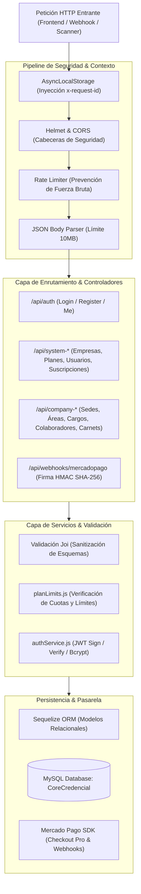

# DIRECCIÓN TIC
## Manual Técnico de Arquitectura Backend y Referencia de API REST
### Aplicativo Carnet Digital (Versión 2026)

---

## Control de versiones

| Fecha | Versión | Autor / Elaboró | Revisó | Modificación | Aprobación |
| :--- | :---: | :--- | :--- | :--- | :--- |
| **28/09/2026** | **2.5.0** | Ing. Especialista TIC<br>Arquitectura Backend | Dirección de Planeación y TIC | Transición de marca a Carnet Digital, reestructuración bajo la Guía de Estilo de Microsoft y documentación técnica exhaustiva de servicios backend. | Dirección TIC /<br>Rectoría |

### Firmas de responsabilidad institucional

| Elaboró / Modificó | Revisó | Aprobó |
| :--- | :--- | :--- |
| **Ing. Especialista TIC**<br>Arquitectura de Software & Backend<br>Dirección TIC<br>*Fecha: 28 de septiembre de 2026* | **Directora de Planeación y TIC**<br>Dirección de Planeación (E)<br>Institución / Organización<br>*Fecha: 28 de septiembre de 2026* | **Dirección General / Rectoría**<br>Dirección Ejecutiva Institucional<br>Institución / Organización<br>*Fecha: 28 de septiembre de 2026* |

---

## Introducción

El núcleo de servicios backend de **Carnet Digital** proporciona la lógica de negocio, persistencia relacional, mecanismos criptográficos y orquestación transaccional de toda la plataforma de credencialización.

El sistema implementa una arquitectura en capas desacopladas (**Rutas**, **Controladores**, **Servicios**, **Modelos** y **Tareas en Segundo Plano**), asegurando la separación estricta de responsabilidades, alta mantenibilidad y cumplimiento de las mejores prácticas de la industria.

Construido sobre **Node.js** con el framework **Express 5** y el ORM **Sequelize** para **MySQL**, el backend opera bajo un modelo multi-inquilino (*multi-tenant*) seguro. Este modelo garantiza el aislamiento de datos entre empresas cliente mediante particionamiento lógico, al tiempo que unifica la administración de tarifas comerciales, suscripciones y auditoría a través de una consola SuperAdmin centralizada.

---

## Contenido general

1. **Capítulo 1: Información general y catálogo tecnológico**
2. **Capítulo 2: Variables de entorno (`.env`) y configuración de conexiones**
3. **Capítulo 3: Ciclo de vida del servidor y pipeline de peticiones**
4. **Capítulo 4: Contexto asíncrono y auditoría automática (`AsyncLocalStorage`)**
5. **Capítulo 5: Modelo de datos relacional y asociaciones Sequelize**
6. **Capítulo 6: Seguridad, autenticación JWT y control de acceso (RBAC)**
7. **Capítulo 7: Motor de validación de límites de plan (`planLimits.js`)**
8. **Capítulo 8: Catálogo maestro de endpoints (API Reference completa)**
9. **Capítulo 9: Tareas asíncronas y jobs en segundo plano (Cron Jobs)**
10. **Capítulo 10: Matriz de auditoría y diagnóstico de errores HTTP**

---

# Capítulo 1. Información general y catálogo tecnológico

El backend de Carnet Digital aprovecha el ecosistema asíncrono no bloqueante de Node.js, diseñado para procesar altos volúmenes de consultas de emisión y validación de códigos QR con latencias ultra-bajas.



| Capa del backend | Librería y versión | Rol y responsabilidad técnica |
| :--- | :--- | :--- |
| **Entorno de ejecución** | Node.js (v18+ LTS / v20+) | Motor de ejecución asíncrono basado en el motor V8 de Google. |
| **Framework web** | Express v5.x | Enrutamiento HTTP de alta velocidad, middlewares y manejo nativo de promesas. |
| **ORM y persistencia** | Sequelize v6.x / mysql2 | Mapeo objeto-relacional, transacciones ACID, modelos y migraciones sobre MySQL. |
| **Autenticación y criptografía** | jsonwebtoken v9.x / bcryptjs v3.x | Emisión y verificación de tokens JWT y hashing seguro de contraseñas (*salt rounds = 10*). |
| **Validación de esquemas** | Joi v18.x | Validación estricta de carga útil (*payloads*), tipos de datos y sanitización de entradas. |
| **Gestión de archivos multipart** | Multer v2.x | Recepción y almacenamiento de fotografías de colaboradores y logotipos institucionales. |
| **Pasarela de pagos** | Mercado Pago SDK v2.x | Generación de preferencias de pago, suscripciones recurrentes y procesamiento de webhooks. |
| **Seguridad perimetral** | Helmet, CORS, Express-Rate-Limit | Blindaje contra XSS, Clickjacking, MIME-sniffing y mitigación de denegación de servicio. |
| **Compresión de datos** | Compression v1.x | Compresión Gzip / Deflate automática de respuestas JSON. |
| **Caché en memoria** | node-cache v5.x | Caché de consultas de alta frecuencia para parámetros globales y credenciales públicas. |
| **Auditoría y trazabilidad** | Winston v3.x / Morgan v1.x | Registro estructurado en formato JSON con rotación diaria y correlación por Request-ID. |
| **Tareas en segundo plano** | node-cron v4.x | Automatización de revisiones diarias para vencimiento de suscripciones y transiciones de estado. |

> [!NOTE]
> La versión 5 de Express adoptada resuelve de forma nativa las promesas en controladores asíncronos sin requerir bloques `try/catch` repetitivos ni envoltorios auxiliares.

---

# Capítulo 2. Variables de entorno (`.env`) y configuración de conexiones

| Variable de entorno | Tipo | Valor predeterminado / Ejemplo | Propósito en la arquitectura |
| :--- | :--- | :--- | :--- |
| `PORT` | Number | `4000` | Puerto TCP en el que escucha el servidor HTTP (Fallback: 3010). |
| `NODE_ENV` | String | `development / production` | Modo de ejecución. En producción silencia trazas internas y optimiza cachés. |
| `DB_HOST` | String | `localhost` | Dirección IP o nombre de host del motor MySQL. |
| `DB_USER` | String | `root` | Nombre de usuario con privilegios de lectura/escritura en la base de datos. |
| `DB_PASSWORD` | String | `********` | Contraseña de acceso a la base de datos MySQL. |
| `DB_NAME` | String | `CoreCredencial` / `carnet_digital` | Nombre del esquema de base de datos relacional. |
| `DB_DIALECT` | String | `mysql` | Dialecto Sequelize configurado para el motor MySQL. |
| `DB_TIMEZONE` | String | `-05:00` | Zona horaria aplicada en la conexión SQL (Bogotá / Lima / Quito). |
| `APP_TIMEZONE` | String | `America/Bogota` | Fija `process.env.TZ` para cálculos uniformes de fechas en Node.js. |
| `JWT_SECRET` | String | Clave hexadecimal 32+ chars | Semilla criptográfica para firma y validación de tokens JWT. |
| `JWT_EXPIRES_IN` | String | `1h` | Vigencia del token de sesión emitido. |
| `ADMIN_DEFAULT_EMAIL` | String | `Admin@admin` | Correo electrónico del SuperAdmin sembrado automáticamente en el primer arranque. |
| `FREE_PLAN_MAX_USERS` | Integer | `10` | Cuota predeterminada de colaboradores en el plan inicial gratuito. |
| `FREE_PLAN_MAX_TEMPLATES` | Integer | `2` | Cuota predeterminada de plantillas autorizadas en el plan gratis. |
| `FREE_PLAN_MAX_CARNETS` | Integer | `5` | Límite de carnets emitidos en el plan gratuito inicial. |
| `MERCADOPAGO_TEST_PUBLIC_KEY` | String | `APP_USR-...` | Clave pública del SDK de Mercado Pago en modo Sandbox. |
| `MERCADOPAGO_TEST_ACCESS_TOKEN` | String | `APP_USR-...` | Token de acceso a la API REST de Mercado Pago en Sandbox. |
| `MERCADOPAGO_PROD_ACCESS_TOKEN` | String | `APP_USR-...` | Token de acceso en producción para cobros en línea. |
| `BACKEND_URL` | String | `http://localhost:4000` | URL base pública del backend para conformar la URL de webhook. |
| `MERCADOPAGO_BACK_URL` | String | `http://localhost:5173/payment-success` | URL de redirección al frontend tras finalizar el pago. |

> [!CAUTION]
> Nunca incluyas secretos de producción (`JWT_SECRET` o `MERCADOPAGO_PROD_ACCESS_TOKEN`) en repositorios públicos de control de versiones.

---

# Capítulo 3. Ciclo de vida del servidor y pipeline de peticiones

Cada petición HTTP entrante atraviesa un pipeline ordenado de middlewares que garantizan seguridad, descompresión, aislamiento de contexto y captura uniforme de errores:

1. **Contexto asíncrono y correlación:**
   El middleware inicializa `AsyncLocalStorage` y genera un identificador único `x-request-id` (UUIDv4) para trazabilidad completa.
2. **Encabezados de seguridad perimetral (Helmet):**
   Elimina la cabecera `X-Powered-By: Express` e inyecta políticas de protección contra ataques comunes.
3. **Control de acceso de origen cruzado (CORS):**
   Valida que los dominios de origen autorizados puedan consultar la API REST, habilitando métodos seguros (GET, POST, PUT, DELETE, OPTIONS).
4. **Limitador de tasa de peticiones (Rate Limiter):**
   Previene ataques de fuerza bruta limitando peticiones por dirección IP en endpoints sensibles de autenticación.
5. **Descompresión y parseo de cuerpo (JSON Parser):**
   Procesa cargas útiles en formato JSON con límite de tamaño de 10 MB.
6. **Enrutamiento modular:**
   El enrutador principal distribuye la petición hacia el controlador correspondiente.
7. **Middleware global de captura de excepciones:**
   Si ocurre un error no controlado, formatea una respuesta estándar HTTP 500 registrando la traza en los archivos de log.

> [!TIP]
> El pipeline ejecuta una verificación de salud (*Health Check*) en la ruta `GET /api/health` retornando el estado de la base de datos y memoria utilizada.

---

# Capítulo 4. Seguridad, autenticación JWT y control de acceso (RBAC)

El sistema valida la identidad del emisor mediante tokens JWT transmitidos en la cabecera `Authorization`. Existen dos tipos de tokens emitidos por `authService.js`:

| Tipo de usuario | Estructura del payload JWT | Alcance y permisos en el sistema |
| :--- | :--- | :--- |
| **Administrador de Sistema**<br>(`type: 'system'`) | `{ id: 1, email: 'Admin@admin', role: 'admin', type: 'system' }` | Acceso global a empresas, planes, suscripciones, roles y parámetros de la plataforma. No posee restricción de tenant. |
| **Usuario de Empresa**<br>(`type: 'company'`) | `{ id: 5, email: 'carlos@empresa.com', role: 'admin', type: 'company', company_id: 1 }` | Acceso estricto y exclusivo a los recursos de su propia organización (`company_id`). El backend filtra automáticamente cada consulta SQL con `WHERE company_id = ?`. |

### 4.1 Aislamiento de datos multi-inquilino (Multi-Tenant)

Para garantizar la privacidad entre empresas cliente, todas las tablas de tenant (`headquarters`, `areas`, `roles`, `company_users`, `carnet_templates`, `carnets`) contienen la columna `company_id`.

Los controladores y servicios validan de forma obligatoria que `req.user.company_id` coincida con el registro solicitado, previniendo vulnerabilidades de Insecure Direct Object References (IDOR).

> [!WARNING]
> Ningún usuario de empresa puede leer, modificar o revocar carnets de otra empresa, incluso si conoce el ID numérico del recurso ajeno.

---

# Capítulo 5. Modelo relacional de datos y entidades

### 5.1 Tablas del núcleo de plataforma (Sistema)

| Tabla / Modelo | Columnas principales | Propósito en la arquitectura |
| :--- | :--- | :--- |
| `companies` (`Company`) | `id, name, nit, email, phone, status, plan_id, created_at` | Directorio maestro de organizaciones cliente suscritas. |
| `system_plans` (`SystemPlan`) | `id, name, description, price_monthly, price_yearly, max_users, max_templates, max_carnets, max_headquarters` | Definición de paquetes y cuotas comerciales. |
| `system_subscriptions` (`SystemSubscription`) | `id, company_id, plan_id, status, start_date, end_date, mp_subscription_id, payment_method` | Monitoreo de vigencia, cobranzas y pasarela. |
| `system_users` (`SystemUser`) | `id, name, email, password, role_id, status` | Cuentas de operadores y administradores centrales. |
| `system_roles` (`SystemRole`) | `id, name, description, permissions` | Matriz de privilegios para usuarios del sistema central. |
| `system_parameters` (`SystemParameter`) | `id, key, value, description` | Banderas globales: modo de mantenimiento y llaves de pago. |

### 5.2 Tablas operativas de empresa (Tenant)

| Tabla / Modelo | Columnas principales | Propósito en la organización |
| :--- | :--- | :--- |
| `headquarters` (`Headquarter`) | `id, company_id, name, address, city, status` | Sedes físicas y sucursales de la empresa. |
| `areas` (`Area`) | `id, company_id, headquarter_id, name, status` | Departamentos o dependencias adscritas a sedes. |
| `roles` (`Role` / Cargo) | `id, company_id, area_id, name, description` | Cargos y puestos de trabajo laborales. |
| `company_users` (`Colaborador`) | `id, company_id, headquarter_id, area_id, role_id, doc_type, doc_number, first_name, last_name, email, photo_url, status` | Directorio completo del personal a credencializar. |
| `carnet_templates` (`Template`) | `id, company_id, name, orientation, background_url, design_json, is_default` | Estructura de capas visuales y marcadores dinámicos. |
| `carnets` (`Carnet`) | `id, company_id, user_id, template_id, qr_hash, issue_date, expiration_date, status, pdf_url` | Credenciales digitales emitidas provistas de hash QR. |

---

# Capítulo 6. Motor de control de límites de plan (`planLimits.js`)

Antes de persistir cualquier recurso de empresa en la base de datos, el sistema invoca la función central `checkPlanLimit()`:

```javascript
await checkPlanLimit(companyId, 'users' | 'areas' | 'roles' | 'templates' | 'carnets' | 'headquarters');
```

Este motor ejecuta el siguiente flujo de validación:
1. Consulta el plan activo y la suscripción vigente de la empresa.
2. Si la suscripción está vencida, lanza un error HTTP 403: *"Su suscripción ha expirado. Por favor renueve su plan"*.
3. Cuenta los registros actuales del recurso solicitado en la base de datos.
4. Compara la cantidad existente contra la cuota permitida en el plan (`max_users`, `max_carnets`, etc.).
5. Si el límite fue alcanzado, rechaza la operación con código HTTP 403 e indica la cuota máxima permitida.

> [!ALERT]
> Esta verificación atómica a nivel de backend previene que usuarios maliciosos emitan carnets excedentes eludiendo los controles visuales del frontend.

---

# Capítulo 7. Catálogo maestro de endpoints (API Reference)

| Método y Ruta | Acceso requerido | Carga útil (*Payload*) / Parámetros | Respuesta exitosa |
| :--- | :--- | :--- | :--- |
| `POST /api/auth/login` | Público | `{ email, password }` | `200 OK: { token, user, branding }` |
| `POST /api/auth/register` | Público | `{ company_name, nit, email, password, phone, plan_id }` | `201 Created: { company, user, payment_url }` |
| `GET /api/auth/me` | Bearer JWT | Cabecera Authorization | `200 OK: { user, company, permissions }` |
| `GET /api/auth/payment-config` | Público | Ninguno | `200 OK: { public_key, currency }` |
| `GET /api/companies` | SuperAdmin | Filtros: `?search, ?status, ?page` | `200 OK: { companies: [], total, pages }` |
| `POST /api/companies` | SuperAdmin | `{ name, nit, email, phone, plan_id }` | `201 Created: { company }` |
| `PUT /api/companies/:id` | SuperAdmin | `{ name, nit, email, phone, status }` | `200 OK: { company actualizado }` |
| `GET /api/plans` | Público / Autenticado | Ninguno | `200 OK: [ { id, name, price, limits } ]` |
| `POST /api/plans` | SuperAdmin | `{ name, price_monthly, max_users, max_carnets }` | `201 Created: { plan }` |
| `GET /api/subscriptions` | SuperAdmin | Filtros: `?status, ?company_id` | `200 OK: [ { subscription } ]` |
| `GET /api/headquarters` | Empresa (Tenant) | Cabecera con Token de Empresa | `200 OK: [ { id, name, address, city } ]` |
| `POST /api/headquarters` | Empresa (Tenant) | `{ name, address, city }` | `201 Created: { headquarter }` |
| `GET /api/areas` | Empresa (Tenant) | `?headquarter_id` | `200 OK: [ { id, name, headquarter_id } ]` |
| `POST /api/areas` | Empresa (Tenant) | `{ name, headquarter_id }` | `201 Created: { area }` |
| `GET /api/cargos` | Empresa (Tenant) | `?area_id` | `200 OK: [ { id, name, area_id } ]` |
| `POST /api/cargos` | Empresa (Tenant) | `{ name, area_id }` | `201 Created: { cargo }` |
| `GET /api/colaboradores` | Empresa (Tenant) | `?search, ?area_id, ?status, ?page` | `200 OK: { colaboradores: [], total }` |
| `POST /api/colaboradores` | Empresa (Tenant) | Multipart: `doc_type, doc_number, first_name, last_name, photo` | `201 Created: { colaborador }` |
| `GET /api/templates` | Empresa (Tenant) | Cabecera con Token de Empresa | `200 OK: [ { id, name, design_json } ]` |
| `POST /api/templates` | Empresa (Tenant) | `{ name, orientation, design_json, background_url }` | `201 Created: { template }` |
| `GET /api/carnets` | Empresa (Tenant) | `?user_id, ?status, ?page` | `200 OK: { carnets: [], total }` |
| `POST /api/carnets` | Empresa (Tenant) | `{ user_id, template_id, expiration_date }` | `201 Created: { carnet, qr_hash, pdf_url }` |
| `DELETE /api/carnets/:id` | Empresa (Tenant) | ID del carnet a revocar | `200 OK: { message: 'Carnet revocado' }` |
| `GET /api/carnets/verify/:hash` | Público | Hash único del código QR | `200 OK: { valid: true, colaborador, vigencia }` |
| `POST /api/webhooks/mercadopago` | Público (Firma HMAC) | Header: `x-signature`, Body: `{ data: { id } }` | `200 OK: { received: true }` |

---

# Capítulo 8. Tareas asíncronas y jobs en segundo plano (Cron Jobs)

El aplicativo programa procesos desatendidos mediante la librería `node-cron` (`src/jobs/subscriptionExpiryJob.js`), garantizando la integridad del estado de las empresas cliente sin requerir intervención manual:

| Nombre del Job | Expresión Cron / Frecuencia | Acción ejecutada |
| :--- | :--- | :--- |
| `subscriptionExpiryJob` | `5 0 * * *`<br>(Todos los días a las 00:05 AM) | 1. Busca suscripciones cuya fecha de finalización (`end_date`) sea inferior al día actual.<br>2. Cambia el estado de la suscripción a `expired`.<br>3. Actualiza el estado de la empresa asociada a `inactive`.<br>4. Registra en el log de auditoría las empresas deshabilitadas. |
| `tempFilesPurgeJob` | `0 3 * * 0`<br>(Domingos a las 03:00 AM) | 1. Inspecciona la carpeta temporal `uploads/`.<br>2. Elimina archivos temporales de PDF o fotos que no hayan sido vinculados a un carnet en los últimos 7 días. |

---

# Capítulo 9. Matriz de auditoría y diagnóstico de errores HTTP

El servidor responde bajo el protocolo estándar HTTP y encapsula los errores mediante un formato JSON consistente:

```json
{
  "success": false,
  "error": "Mensaje comprensible para el usuario o desarrollador",
  "requestId": "c4b91f1a-8e2b-4e12-b9d1-9f2e4a8c16b3",
  "timestamp": "2026-09-28T17:30:00.000Z"
}
```

| Código HTTP | Significado técnico | Causa habitual en Carnet Digital |
| :--- | :--- | :--- |
| **200 OK** | Petición exitosa | Consulta o actualización completada satisfactoriamente. |
| **201 Created** | Recurso creado | Creación exitosa de empresa, colaborador, plantilla o carnet. |
| **400 Bad Request** | Carga útil inválida | Faltan campos obligatorios o no superan las validaciones Joi. |
| **401 Unauthorized** | No autenticado | Token JWT ausente, expirado o con firma criptográfica inválida. |
| **403 Forbidden** | Acceso denegado / Cuota agotada | Usuario intentando acceder a otra empresa o cuota máxima del plan excedida. |
| **404 Not Found** | Recurso no encontrado | El ID solicitado no existe en la base de datos. |
| **409 Conflict** | Conflicto de unicidad | NIT o correo electrónico ya registrado previamente. |
| **429 Too Many Requests** | Límite de tasa excedido | Demasiados intentos de autenticación en un lapso corto. |
| **500 Internal Error** | Error interno no controlado | Excepción de base de datos o fallo en el servidor. |
